# Aholo Creator Copilot

**An AI production copilot that turns a product description into an export-ready 3D asset.**

Describe your product in any language, by text or voice, and optionally add a photo. The Copilot plans the production, runs it on **Aholo Lux3D**, checks the result, takes changes in conversation, and hands you files for your online store, AR and 3D tools.

Built for the **Manycore Aholo Global 3D AI Hackathon** (November 2026).

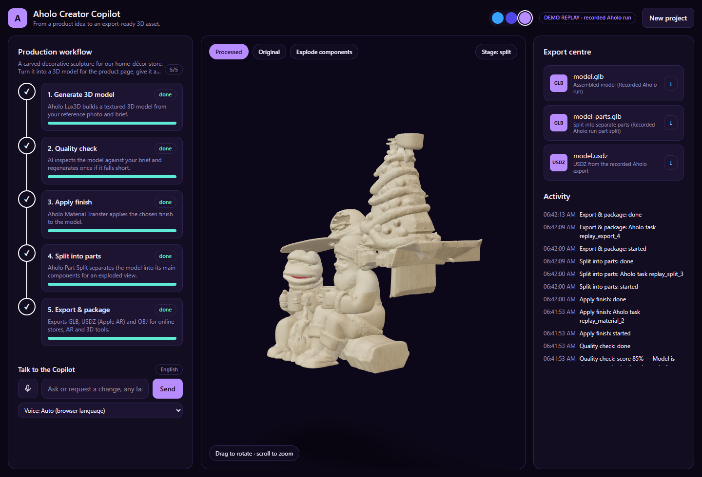

---

## 1. The problem

Products sell better when customers can see them in 3D: rotating them on a product page, placing them in their room with AR, or ordering a 3D-printed version. Shopify reports that merchants using 3D have seen an average **94% increase in conversions** compared to photos alone [[1]](#sources).

Getting a product into 3D is still out of reach for most businesses:

- **It is expensive and slow.** A professionally modelled e-commerce product typically costs **$200 to $1,000 per product**, more for complex items, and takes days [[2]](#sources)[[3]](#sources). For a shop with 50 products, that is a five-figure project.
- **AI generators only solve part of it.** Tools like Lux3D can now produce a 3D model in about two minutes. But that is a *raw model*. Turning it into a usable product asset still means knowing which operations to chain (a different finish, separating the parts, converting formats), which file each channel needs (USDZ for Apple AR, OBJ/FBX for 3D tools, STL/3MF for printing), and how to handle slow tasks, failures and credit costs.
- **The tools speak "3D", not "business".** They expect technical settings, in English. A shop owner thinks in terms of *"show my sculpture in sandstone, and let customers look at each part"*.

**Small online sellers, makers and product teams** have the products and the need, but neither a 3D artist's budget nor the time to learn a 3D pipeline.

## 2. The solution

Aholo Creator Copilot is the **production assistant** between the business owner and the 3D engine. You describe the outcome you want, and it takes care of the production:

| You do | The Copilot does |
|---|---|
| Describe the product in your own words and language | Understands the request (Gemini) and plans the steps |
| Review the plan (optional tweaks) | Runs each step on Aholo Lux3D and tracks progress |
| Watch, or ask questions | Checks the model with AI vision and regenerates if it clearly falls short |
| Ask for changes ("make it walnut") | Re-runs only the affected steps, confirming expensive ones first |
| Download | Delivers GLB, split-parts GLB, USDZ and OBJ |

## 3. How it works, step by step

> The screenshots below come from the app's **demo replay**, which plays back a real Lux3D run recorded on 16 Nov 2026 (a carved sculpture). The live mode looks and works the same, with real timings.

### Step 1: Describe the product

Write what you want in plain language, in any language, and optionally add a photo. Without a photo, the model is generated from the text.

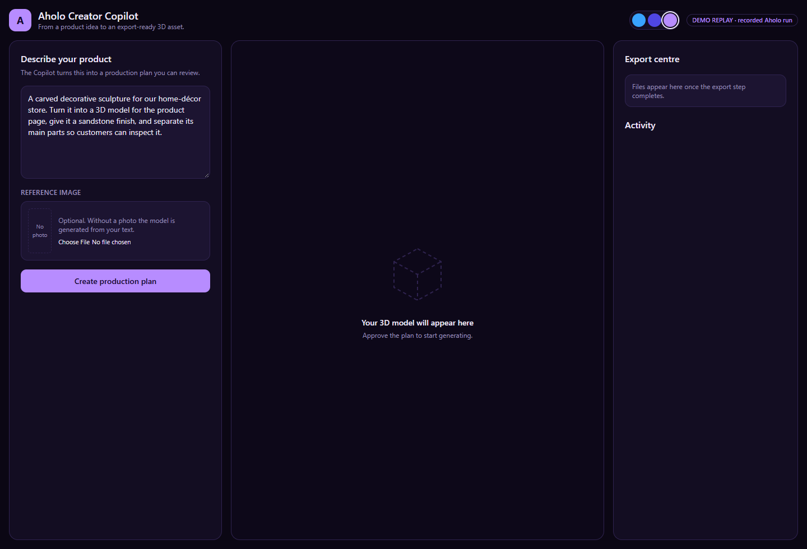

### Step 2: Review the production plan

The Copilot turns the brief into a plan: **generate → quality check → apply finish → split into parts → export**. Nothing runs until you approve it. You can pick a finish from presets (or ask for any finish in chat), and remove steps you don't need. For example, you can drop the part split to save credits.

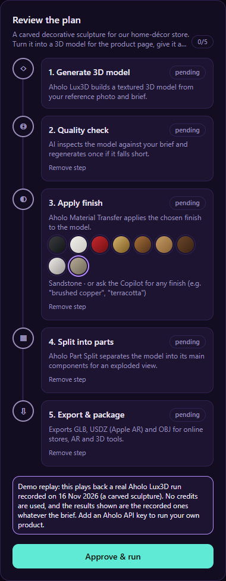

### Step 3: Watch it run

Each step runs on Aholo Lux3D. The step rail shows live progress, a timer and an activity log, so long tasks never look frozen. Changes you request while it runs are queued and applied afterwards. If the page is reloaded or a status check fails, the Copilot resumes the *same* Lux3D task instead of paying for a new one.

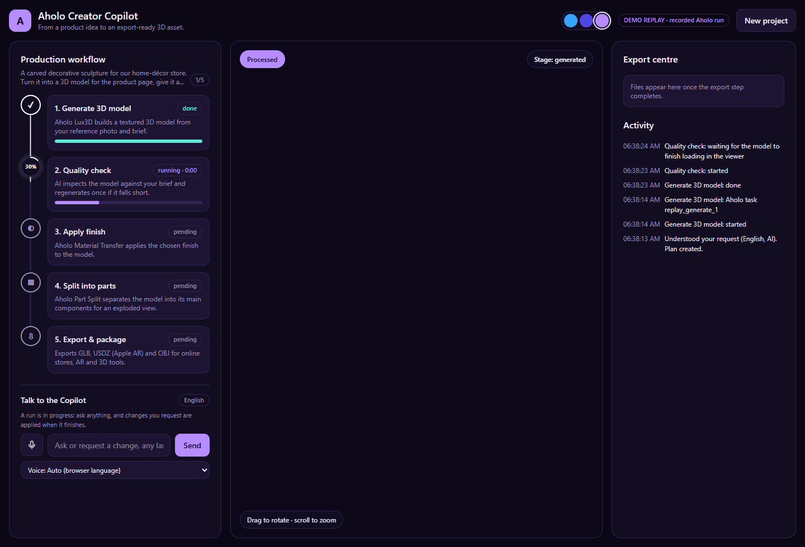

### Step 4: AI quality check

When the model is ready, the Copilot renders it as a **clay render** (uniform grey, so the shape is judged rather than the colour) and asks Gemini to judge it against the brief. If it clearly falls short (under 50%), the Copilot regenerates once. Borderline results are only reported, because a regeneration costs credits and time.

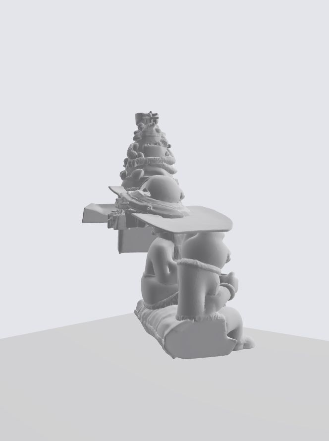

### Step 5: Apply the finish

Lux3D **Material Transfer** applies the chosen finish. The Copilot draws a reference swatch for it: wood grain for wood, a brushed sheen for metal, veins for stone, a weave for fabric. Any finish a user describes ("terracotta", "brushed copper") becomes a swatch too.

| As generated (matte black) | After the sandstone finish |
|---|---|
| 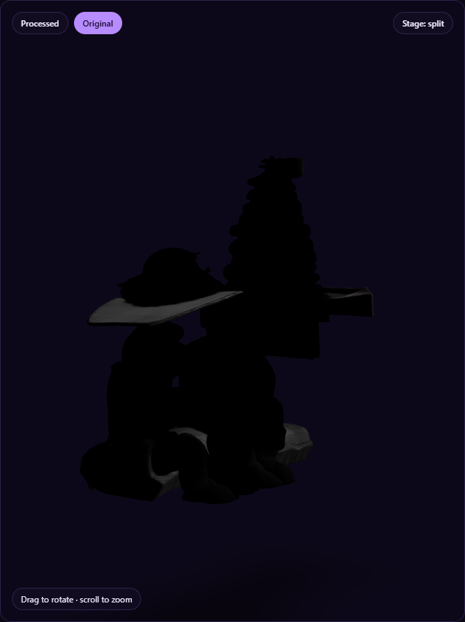 | 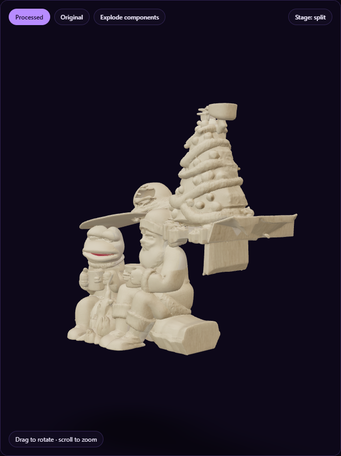 |

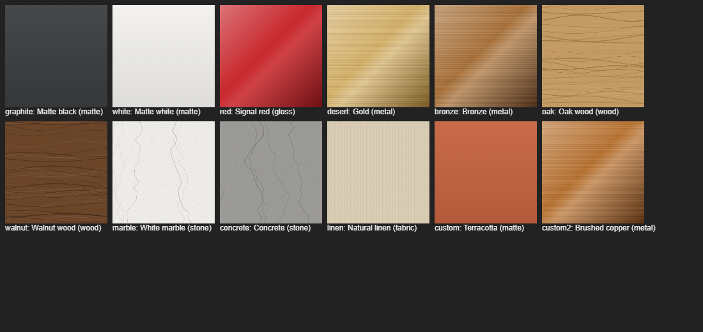

### Step 6: Split into parts

Lux3D **Part Split** separates the model into its main components, and the viewer shows them pulled apart as soon as the split finishes. Because Part Split stores the parts in their assembled positions, the Copilot also builds a separated copy for download, so the parts appear apart in any 3D viewer.

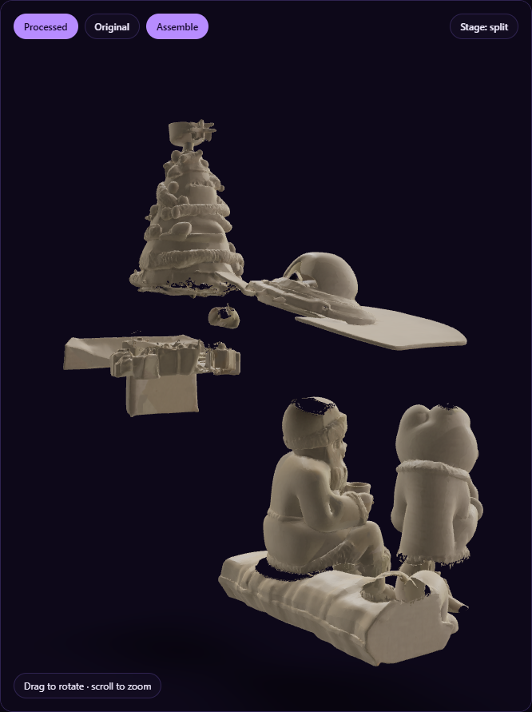

### Step 7: Export

Lux3D **Multi-Format Export** produces the channel formats. The export uses the assembled model, because the export API rejects the split model; the split model is delivered as a separate file.

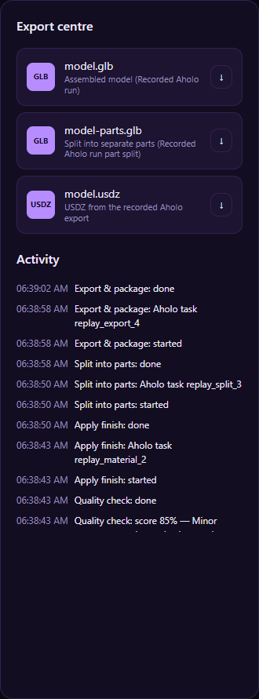

| File | Use |
|---|---|
| `model.glb` | Web product pages, 3D viewers, game engines |
| `model-parts.glb` | The parts already pushed apart and named Part 1, Part 2…, so they open separated in any 3D viewer (built in the browser, no credits) |
| `model-parts-in-place.glb` | The raw Part Split result: the same parts in their assembled positions, to move yourself in Blender or a configurator |
| `model.usdz` | Apple AR Quick Look on iPhone and iPad |
| `model.obj` | 3D tools (Blender, Maya, 3ds Max) |

### Step 8: Talk to it, in any language

The chat understands questions and changes in any language, by text or voice. It knows the project's state (each step's status, errors and recent activity), so it can answer *"What files do I get for AR on an iPhone?"* as well as act on *"¿Puedes separar las piezas?"* in Spanish. Changes that would run an expensive step show the cost and wait for a "yes".

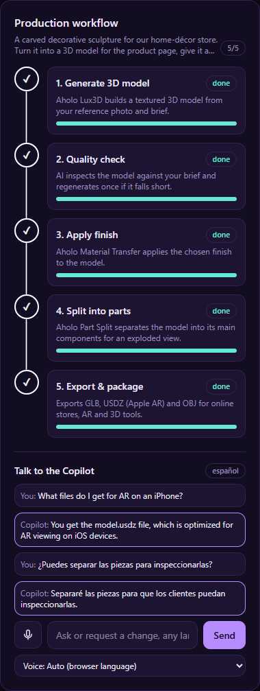

## 4. Under the hood

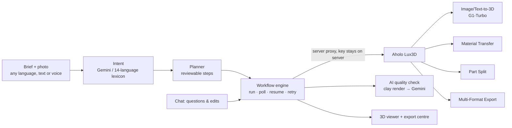

**Lux3D operations used**, measured on live runs (16 Nov 2026):

| Step | Lux3D operation | Time | Credits |
|---|---|---|---|
| Generate | Image-to-3D / Text-to-3D, **G1-Turbo** | ~100 s | 1 |
| Finish | **Material Transfer** `v3.0-standard` | ~4 min | 7 |
| Parts | **Part Split** | ~2 min | 30 |
| Export | **Multi-Format Export** (USDZ, OBJ) | ~30 s | ~1 |
| Photo | **Asset upload** (OUS) | seconds | 0 |

**Design decisions that keep it reliable:**
- **The API key never reaches the browser.** All Lux3D calls go through a small server proxy (`app/api/aholo/*`).
- **Credits are treated as real money.** Expensive changes need a "yes", interrupted tasks are resumed instead of re-bought, and the quality check is never simulated (a fake failure would trigger a paid regeneration).
- **Failures are recoverable.** Retry keeps finished work, and a brief network error doesn't fail a step.
- **One interface, three engines.** `AholoClient` is implemented by `live.ts` (the real API), `replay.ts` (a recorded real run) and `mock.ts` (offline).

Stack: Next.js 15, React 19, TypeScript, Tailwind v4, React Three Fiber, Google Gemini.

## 5. Impact

| | Traditional 3D modelling | With Aholo Creator Copilot |
|---|---|---|
| Cost per product | ~$200–$1,000 [[2]](#sources)[[3]](#sources) | ~9 Lux3D credits, or ~39 with part split |
| Time per product | days | ~8–10 minutes end to end on live runs, mostly waiting on Lux3D |
| Skills needed | 3D modelling software | describe it in your own language |
| Formats | per request | GLB, parts GLB, USDZ, OBJ in one run |

**Who benefits:**
- **Small online sellers** can put their whole catalogue in 3D and AR, a channel associated with much higher conversion [[1]](#sources), without an agency budget.
- **Makers and craft businesses** (like the sculpture in the demo) can show handmade pieces in 3D, in the finishes they offer, and let customers inspect the details.
- **Non-English-speaking businesses** can use the full Lux3D pipeline in their own language, by voice.
- **Product teams** get a fast first 3D draft, split into parts, to review before investing in final production assets.

**For Aholo:** the Copilot turns four separate Lux3D operations into one guided product. That lowers the barrier for non-technical customers, exactly the people with the most products that aren't yet in 3D.

## 6. Try it

```bash
npm install
cp .env.example .env.local
npm run dev            # http://localhost:3000
```

| Mode | When | What you get |
|---|---|---|
| **Demo replay** | no `AHOLO_API_KEY`, or add `?replay=1` | A real recorded Lux3D run in ~40 s. Free, labelled "Demo replay". |
| **Live** | `AHOLO_API_KEY` set | Your own product, end to end on Lux3D (uses credits). |
| Mock | `?mock=1` | Offline simulation; the finish step fails once to show retry. |

Optional: `GEMINI_API_KEY` (free at https://aistudio.google.com/apikey) enables any-language chat and the AI quality check. Without it, a built-in lexicon covers 14 languages and the quality check is skipped.

## 7. Known limitations

- Lux3D result files are 15–20 MB and download at roughly 0.5–1 MB/s, so each result takes 15–30 s to appear in the viewer.
- Photos larger than 5 MB need block upload, which is not implemented yet.
- Projects are saved in the browser (localStorage) only.
- The AI quality check's scores vary between runs; it only acts on clear failures.

## Sources

1. Shopify, *3D model products* (merchants using 3D report an average 94% increase in conversions vs photos alone; a merchant-reported figure, not a controlled study): https://www.shopify.ca/blog/3d-model-products
2. Talo, *How much does 3D modeling cost?* (product models $200–$1,000 per product): https://talo.com/costs/3d-modeling-price
3. Twikit, *How do you get affordable 3D models made of your products?* ($200–$800 per model): https://twikit.com/how-do-you-get-affordable-3d-models-made-of-your-products/
